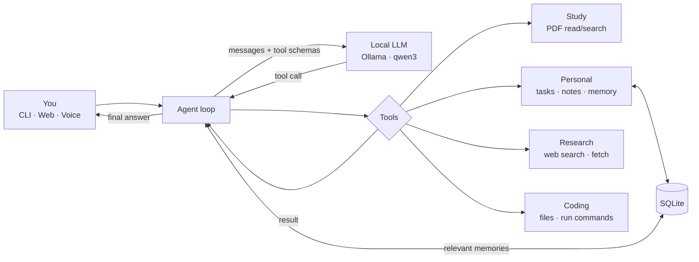

# 🤖 Atlas: a fully local personal AI agent

Atlas is an AI agent that runs on your own computer through [Ollama](https://ollama.com). It does more than chat: it **decides which tools to use, runs them, reads the results and keeps going** until the job is done.

It does four kinds of work:

| | What it does | Example |
|---|---|---|
| 📚 **Study** | Reads and searches your PDFs and notes, explains them, quizzes you | *"Quiz me on chapter 2 of my DBMS notes"* |
| 🗓️ **Personal** | Tasks, deadlines, exams, reminders, notes, long-term memory | *"My OS assignment is due next Friday"* |
| 🔎 **Research** | Searches the web, reads pages, cites sources | *"Compare FastAPI and Flask, with sources"* |
| 💻 **Coding** | Explores, reads, writes and runs code | *"Write a Python script that renames my photos by date, then run it"* |

You can use it in three ways: **terminal**, **web app**, and **voice**.

Everything except web search runs offline. Your data stays in a local SQLite file.

## How it works



1. Your message goes to the model, together with a JSON description of every tool.
2. The model either answers directly or asks for a tool call, for example `add_task(title=…, due=…)`.
3. The agent runs that Python function and sends the result back to the model.
4. Steps 2 and 3 repeat until the model gives a final answer (up to 10 steps).
5. Facts about you are saved to long-term memory. Before each turn, the most relevant ones are added to the prompt.

**Safety:** tools that change things (`write_file`, `run_command`, `delete_task`, `forget`) always ask for your approval first.

## Setup

You need Python 3.10+ and [Ollama](https://ollama.com) running with a model that supports tool calling.

```bash
ollama pull qwen3:14b            # the agent's brain (or qwen3:8b on a 16 GB machine)
ollama pull nomic-embed-text     # optional: memory search by meaning

python3 -m venv .venv
source .venv/bin/activate
pip install -r requirements.txt
pip install -r requirements-voice.txt   # only for voice mode
```

Optionally, copy `.env.example` to `.env` to change the agent's name, model and other settings.

## Run

```bash
python main.py          # terminal
python main.py web      # web app at http://localhost:8501
python main.py voice    # push-to-talk voice assistant
```

**Chat with a document:** in the web app, click the 📎 button in the message box, attach a PDF, TXT or MD file, and ask about it. In the terminal, use `/attach path/to/file.pdf your question`. Short documents are read in full; long ones are searched page by page. Answers cite page numbers, and follow-up questions stay on that document until you start a new conversation.

**Monitoring:** every reply shows how long it took, tokens in and out, how full the model's context window is, and generation speed (tokens per second). The web sidebar has a Monitoring panel with session totals, a context usage bar (it warns when the context is over 85% full) and a response-time chart. In the terminal, type `/stats`. Every reply is also logged to `data/metrics.jsonl`.

You can also put files in `documents/` yourself. Coding tasks use the `workspace/` folder.

### Terminal commands
`/help` · `/attach` · `/stats` · `/tasks` · `/memory` · `/tools` · `/model <name>` · `/reset` · `/exit`

## Project structure

```
agent/
  core.py        agent loop: model ↔ tools, history, safety checks
  llm.py         Ollama client (chat + tool calling, embeddings)
  memory.py      long-term memory (embeddings, with keyword fallback)
  storage.py     SQLite: memories, notes, tasks
  config.py      settings (.env / environment variables)
  tools/
    base.py      @tool decorator that builds JSON schemas from Python signatures
    study.py     list/read/search documents
    personal.py  time, tasks, notes, remember/recall
    research.py  web_search, fetch_webpage
    coding.py    list/read/write/search files, run_command
interfaces/
  cli.py · web.py · voice.py
tests/           unit tests with a fake LLM (no Ollama needed)
```

## Add your own tool

Write a plain Python function and decorate it. The schema is generated from the function's signature:

```python
from agent.tools.base import tool

@tool("Convert Celsius to Fahrenheit.", params={"celsius": "Temperature in °C"})
def to_fahrenheit(celsius: float) -> str:
    return f"{celsius * 9 / 5 + 32:.1f} °F"
```

Import the module in `agent/tools/__init__.py` and the agent can use it.

## Tests

```bash
pytest -q
```

## Roadmap
- [ ] Gmail and Google Calendar tools
- [ ] Desktop notifications for reminders
- [ ] Streaming replies in the web UI
- [ ] Vector search over documents (RAG with chunk embeddings)
- [ ] Wake word ("Hey Atlas") for voice mode
