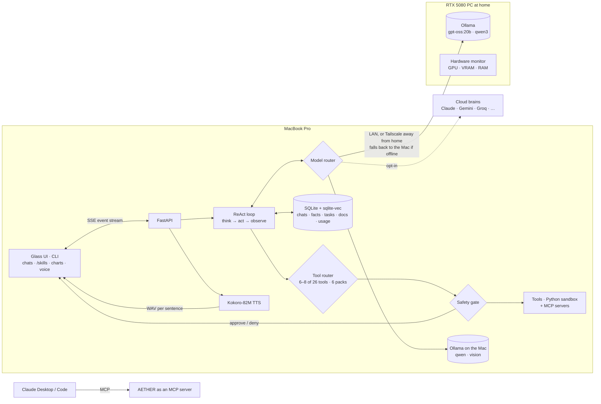

<div align="center">

# ◉ AETHER

### A local-first autonomous AI agent for study, research & productivity

*Runs entirely on your own computer: it plans, uses tools, remembers you, sees images, and talks back in a natural voice.*


-7DD3FC)


[](LICENSE)

<!-- Record per docs/DEMO_SCRIPT.md → shot list, then save as docs/media/hero.gif -->


</div>

---

## Why AETHER is an *agent*, not a chatbot

A chatbot answers. **AETHER works.** Give it a goal and it runs an explicit **ReAct loop**: it thinks, picks a tool, runs it, reads the result and decides what to do next, until the job is done. Every step streams to the UI live.

> **You:** *"Here's my timetable"* + 📷 screenshot
> **AETHER:** switches to a vision model → reads the image → `add_class` × 3 → *"Saved DBMS (Mon 9–10, Room 204), Operating Systems (Tue 11–12, Lab 2) and Statistics (Wed 2–3, Room 101)."*
>
> ⚡ `4 steps · add_class → add_class → add_class · 12.8s · local`

It does this with **no cloud API**: a local model through [Ollama](https://ollama.com), and a local SQLite memory, vector search and neural voice. When you want more power, you can opt in to a **cloud brain**: 11 providers, 7 of them with free tiers (Gemini, Groq, OpenRouter, Mistral, Cerebras, GitHub Models, Hugging Face) plus Claude, OpenAI, DeepSeek and Grok. The UI marks it clearly, and memory, documents and voice stay local.

## Highlights

| | |
|---|---|
| 🧠 **Transparent ReAct engine** | Hand-written agent loop (no LangChain). Streams 10 typed events: thoughts, tokens, tool calls, approvals, memory |
| 🛡️ **Human-in-the-loop safety** | Risky actions (shell, Python, deleting, overwriting) **pause the agent** until you approve, with a plain-English risk summary |
| 📚 **Hybrid RAG** | PDFs, PowerPoint (incl. speaker notes) and Markdown. Embeddings + BM25 fused with weighted RRF, with citations like `[notes.pdf p.3]` |
| 🗂️ **Dual memory** | Every conversation persisted; long-term facts learned automatically, with near-duplicate merging, and fully editable |
| 👁️ **Vision** | Drop a screenshot; AETHER switches to an installed vision model **only for that answer**, then acts on what it sees |
| 🔌 **MCP client** | Plug in external [Model Context Protocol](https://modelcontextprotocol.io) servers (filesystem, GitHub, …) with per-server approval policies |
| 🎓 **Interactive study** | Quizzes become glass cards: multiple choice or 3D flip-cards. Weak topics are tracked and fed back into its memory |
| 🗓️ **Planner** | Deadlines and timetable in SQLite. Natural dates (*"next Friday 5pm"*) resolved **in code**; .ics export with alarms |
| 🎙️ **Neural voice** | Kokoro-82M, synthesised locally ~6× faster than real time, played **gaplessly** sentence by sentence, with a symbiote that ripples to the voice |
| 📊 **Telemetry** | Every reply shows its tool chain, steps, tokens, context-window use and latency |
| 🖥️ **Mac + GPU PC, anywhere** | Runs models on an RTX 5080 PC over the home network or Tailscale; if the PC is off, that answer runs on the Mac. Live GPU load, VRAM and link quality |
| 🧩 **Reasoning control** | `gpt-oss` reasoning Low · Med · High from the input box, and a "Thought for 3.8s" card with its reasoning |
| ⚡ **Skills** | `/brief`, `/quiz`, `/deep` and your own: plain Markdown playbooks in `backend/skills/` |
| 🎯 **Tool packs + router** | 26 tools in 6 packs; small local models get only the 6–8 relevant ones (keywords + meaning), and can load a pack mid-task |
| 📈 **Code & charts** | A sandboxed Python interpreter (numpy, pandas, matplotlib); charts appear inline with a Download button |
| 🔁 **MCP both ways** | Use any MCP server (local or URL) in AETHER, and let Claude Desktop / Code use AETHER's study tools |
| ☁️ **Cloud, opt-in** | 11 providers (7 with free tiers) with a Usage tab: spend, tokens, context and a monthly budget |
| ✨ **Liquid-glass UI** | Next.js + Framer Motion: drifting light, cursor parallax, frosted glass, spring physics and a living amoeba-like symbiote that reacts to what the agent is doing (with a Calm mode) |

## How it works



1. Your goal arrives with **memory context**: relevant facts, upcoming deadlines, today's classes and your weak quiz topics.
2. The model streams tokens and tool calls. AETHER **validates and repairs** the arguments (small models often send `"5"` for `5`, or JSON inside text).
3. Safe tools run at once. Risky ones emit `approval_required`, and the loop **waits on an `asyncio.Future`** until you click Approve or Deny.
4. Results feed back into the loop until there's an answer. Then a quiet pass saves anything lasting it learned about you.

Full design: **[docs/ARCHITECTURE.md](docs/ARCHITECTURE.md)** (system and sequence diagrams, event protocol, design decisions).

## Feature tour

| | |
|---|---|
| <br/>**Safety gate.** A delete pauses the agent; Deny is focused by default | <br/>**Your notes, cited.** Answers come from your PDFs and slides, with page numbers |
| <br/>**Screenshot → actions.** A timetable photo becomes classes in the database | <br/>**Quiz cards.** Spring-animated cards; misses become weak topics |
| <br/>**Natural voice.** The symbiote ripples with the actual speech | <br/>**Telemetry.** The tool chain, tokens and latency of every reply |

<sub>GIFs: record them with the shot list in [docs/DEMO_SCRIPT.md](docs/DEMO_SCRIPT.md).</sub>

## Tools

26 tools in six packs. Small local models are offered only the 6–8 a message needs (matched by tags and by meaning with `nomic-embed-text`), plus `list_available_capabilities` to load a whole pack mid-task. Packs can be switched off or pinned (`GET/PUT /api/packs`).

| Pack | Tools | Level |
|---|---|---|
| `knowledge_rag` | `search_knowledge_base` (hybrid vector + BM25, cited), `list_documents`, `ingest_any_file` (PDF, Word, PowerPoint, Excel/CSV, code, notebooks, images via a local vision model), `read_file`, `list_files`, `write_note`, `create_pdf`, `make_quiz`, `delete_file` | safe / write / **delete asks** |
| `code_data` | `python_sandbox` (numpy, pandas, matplotlib, sympy; 15 s; charts inline), `analyze_dataset` (profile + safe filter / group / aggregate / sort), `python_calculator` (AST, never `eval`), `run_python` | sandbox & Python **ask first** |
| `research_web` | `web_search` (4 fallback sources), `read_webpage` (blocks private IPs), `youtube_transcript`, `arxiv_wiki_lookup` (arXiv + Wikipedia) | safe; says so when offline |
| `productivity` | `add_task`, `manage_tasks`, `add_class`, `manage_timetable`, `remember`, `recall_memory`, `forget` | write; deleting asks first |
| `system_mac` | `run_shell_command` (Wave 2 adds apps, Calendar, Reminders, clipboard, Spotlight) | **always asks** |
| `mcp_bridge` | anything your MCP servers expose | read-only runs freely; the rest asks |

Adding a tool is one decorated function. The JSON schema comes from the type hints:

```python
@tool(description="Convert Celsius to Fahrenheit.", params={"celsius": "Temperature in °C"})
def to_fahrenheit(celsius: float) -> str:
    return f"{celsius * 9 / 5 + 32:.1f} °F"
```

## Making a 7B model behave like an agent

Small local models are fast and private, but unreliable. Most of AETHER's engineering went into making them dependable. Each item below came from a failure seen in live testing:

| Problem seen in testing | Fix |
|---|---|
| A valid tool call, followed by **12,930 tokens of hidden junk** (a 5-minute hang) | Output cap + close the stream 2.5 s after a tool call arrives: **53 s → 13 s** |
| *"Next Friday"* saved as a Tuesday | The model passes your words; **Python resolves the date** |
| *"I've tracked it"* after the tool call **failed** | The engine sends the model back once with the exact error |
| Tool calls written as text in code fences, with trailing commas | A lenient parser recovers them, plus a format-retry prompt |
| A quiz written as plain text instead of cards | An intent guard re-asks for `make_quiz` |
| Duplicate passages crowding out the right page in RAG | Passage dedup + weighted fusion + a minimum of 5 passages |
| Model reloads between calls | Every call uses the same `num_ctx` |

## Quick start

**Needs:** macOS or Linux, Python 3.11+, Node 20+, and [Ollama](https://ollama.com).

```bash
ollama pull qwen2.5:7b          # the brain: fast, reliable tool calling
ollama pull nomic-embed-text    # embeddings for RAG and memory
ollama pull qwen3.5:4b          # optional: vision + tools (screenshots)
```

```bash
git clone https://github.com/Piyuz-ui/aether.git && cd aether
./start.sh
```

`start.sh` sets everything up on the first run, checks Ollama, starts the backend and web app, and opens **http://localhost:3000**. **Ctrl+C** stops both. The voice model (~350 MB) downloads the first time AETHER speaks.

<details>
<summary><b>Manual setup, CLI and tests</b></summary>

```bash
# backend
cd backend
python3 -m venv .venv && source .venv/bin/activate
pip install -r requirements.txt
python api.py                 # API on :8000 (docs at /docs)
python cli.py                 # or: the terminal agent

# frontend (second terminal)
cd frontend && npm install && npm run dev

# tests
cd backend && python -m pytest -q
```
</details>

<details>
<summary><b>Use a GPU PC on your network (e.g. RTX 5080)</b></summary>

AETHER can run models on another computer's GPU over your home network. Your data stays private, because nothing goes to the internet. On the Windows PC:

1. Install the latest [Ollama](https://ollama.com/download). Recent versions support RTX 50-series cards.
2. Copy [`pc/setup-ollama-pc.ps1`](pc/setup-ollama-pc.ps1) to the PC. Open PowerShell with **Run as administrator** and run:
   ```powershell
   powershell -ExecutionPolicy Bypass -File setup-ollama-pc.ps1
   ```
   The script asks before each change. It makes Ollama listen on your network, opens port 11434 for **private** networks only, downloads models that fit 16 GB (`qwen3:14b`, `gpt-oss:20b`, `qwen3-vl:8b`), and prints the PC's address.
3. On the Mac, open **Settings → Computers on your network**, type the address and press **Connect**.

The PC's models then appear in the model menu as `model@pc`, and telemetry shows `local · pc`.

**See the hardware live.** **Settings → Hardware** shows a card for each machine. For this Mac: the chip, GPU cores and unified memory in use. For the PC: the GPU name, VRAM, GPU load, temperature, power and RAM. Each card also lists which models are loaded and how much of each sits on the GPU (anything under 100% means part of the model spilled onto the slower CPU). Each PC card also says whether the PC is **available**: ready, on but Ollama not running, or offline/asleep. It rates the **connection** from the Mac as excellent, good, fair or poor, based on delay, jitter and lost attempts, measured every few seconds against the PC's Ollama port (Windows blocks ping). Each machine's own link is shown too: Wi-Fi signal and band, or cable and link speed. While a model on the PC is answering, the reply also shows one quiet line of live GPU activity: a load sparkline, VRAM and temperature (`▁▃▆█ 96% · 13.8/15.9 GB · 48° pc`). It fades away when the reply is done. The PC's numbers come from a small read-only monitor. Install it once, in an administrator PowerShell window:
```powershell
Invoke-WebRequest https://raw.githubusercontent.com/Piyuz-ui/aether/main/pc/install-hardware-monitor.ps1 -OutFile "$env:USERPROFILE\Downloads\install-hardware-monitor.ps1"
powershell -ExecutionPolicy Bypass -File "$env:USERPROFILE\Downloads\install-hardware-monitor.ps1"
```
It answers `GET /stats` on port 11435 (private networks only) and starts hidden at login. Uninstall steps are at the top of the script. If the PC is off, AETHER falls back to the Mac's models. Images can also be routed to a vision model on the PC. Embeddings and memory stay on the Mac. Ollama has no password, so never forward port 11434 on your router. **Use it from anywhere (college, a café, a hotspot).** AETHER uses [Tailscale](https://tailscale.com), a free private network that only your own devices can join. Nothing is opened to the internet and your router isn't changed. On the PC, run [`pc/setup-remote-access.ps1`](pc/setup-remote-access.ps1) the same way as the setup script. It installs Tailscale (log in when the browser opens), opens Ollama and the hardware monitor to your Tailscale devices only, keeps the PC awake while it's plugged in, and prints its remote address. Install Tailscale on the Mac with the same account, then add that address as the PC's **Remote address** in Settings. AETHER uses the home address when it answers and the remote one everywhere else, and switches by itself. The Hardware view shows which route is in use and rates its connection. If the PC can't be reached at all, AETHER falls back to the Mac's models. You can also set hosts in `backend/.env`: `AETHER_OLLAMA_HOSTS={"pc": "http://192.168.1.50:11434"}`.
</details>

<details>
<summary><b>Add cloud brains (optional)</b></summary>

Local models are always the default. To add a cloud model, open **Settings → Cloud brains**, paste a key and press **Connect**. AETHER checks the key with the provider, then saves it to `backend/.env` (gitignored, readable only by you). You can also put the key in `backend/.env` yourself:

| Provider | Free tier | Key (in `backend/.env`) | Model names |
|---|---|---|---|
| Google Gemini | yes | `GEMINI_API_KEY` from [AI Studio](https://aistudio.google.com/apikey) | `gemini:gemini-2.5-flash`, … |
| Groq | yes | `GROQ_API_KEY` from [console.groq.com](https://console.groq.com/keys) | `groq:llama-3.3-70b-versatile`, … |
| OpenRouter | yes (`:free` models) | `OPENROUTER_API_KEY` from [openrouter.ai](https://openrouter.ai/keys) | `openrouter:<model>:free` |
| Mistral AI | yes ("Experiment" plan) | `MISTRAL_API_KEY` from [console.mistral.ai](https://console.mistral.ai/api-keys) | `mistral:mistral-medium-latest`, … |
| Cerebras | yes | `CEREBRAS_API_KEY` from [cloud.cerebras.ai](https://cloud.cerebras.ai) | `cerebras:gpt-oss-120b`, … |
| GitHub Models | yes (daily limits) | `GITHUB_MODELS_TOKEN`: a [GitHub token](https://github.com/settings/personal-access-tokens) with `models:read` | `github:openai/gpt-4.1`, … |
| Hugging Face | small monthly credit | `HF_TOKEN` from [huggingface.co](https://huggingface.co/settings/tokens) | `huggingface:<org>/<model>` |
| Anthropic Claude | no (paid) | `ANTHROPIC_API_KEY` from [the Claude Console](https://platform.claude.com/settings/keys) | `claude:claude-opus-5-5`, `claude:claude-sonnet-5-5`, `claude:claude-haiku-5-5` |
| OpenAI | no (paid) | `OPENAI_API_KEY` from [platform.openai.com](https://platform.openai.com/api-keys) | `openai:gpt-5`, … |
| DeepSeek | no (paid, cheap) | `DEEPSEEK_API_KEY` from [platform.deepseek.com](https://platform.deepseek.com/api_keys) | `deepseek:deepseek-chat`, … |
| xAI Grok | no (paid) | `XAI_API_KEY` from [console.x.ai](https://console.x.ai) | `xai:grok-4`, … |

Connected providers appear in the header's model menu, under the local models. Each provider's live model list is used when it can be fetched. While a cloud model is selected, your messages go to that provider, along with any memories and document passages AETHER adds to the prompt. Embeddings, the knowledge vault, memory storage and voice never leave your machine. **Track what it costs.** The **Usage** tab records every cloud request. It shows this month's and today's spend, an optional monthly budget (amber at 80%, red when reached), a 14-day chart, and, per model, its requests, tokens in/out/cached, how full its context got and its cost. Free tiers also show the allowance they report as left (e.g. Groq's requests and tokens). Claude's prices are built in and free tiers count as $0. Prices that change often (OpenAI, DeepSeek, Grok, Hugging Face) aren't guessed: you enter them once, and they apply to past usage too. Each reply's stats chip shows what that answer cost.

Every provider except Claude is used through its OpenAI-compatible API, and only models that can call tools are listed. Claude uses the official Anthropic SDK with refusal fallbacks turned on. AETHER adapts to each provider's quirks on its own. For example, it learns which settings a model refuses and stops sending them, and it uses the tool-call id format Mistral requires.
</details>

<details>
<summary><b>Chats: names and feedback</b></summary>

AETHER names each chat by its topic. It does this after the first reply, then again after the third, when the topic is clearer. It runs in the background, so you can keep typing. In **Chats**, ✏️ renames a chat (your name is never overwritten) and ✨ asks AETHER to name it again. The first three replies of every chat ask *How's this going?* 👍/👎. A 👎 lets you tap a reason and **Ask again**, and the Chats list marks chats that went badly.
</details>

<details>
<summary><b>MCP: more tools, and AETHER inside Claude</b></summary>

**Settings → MCP servers** adds, edits, switches off or removes servers. A server can be a **local command** (stdio) or a **remote URL** (Streamable HTTP; a token goes in a header). Tokens are never shown back in the app. Servers that need a browser sign-in (OAuth) aren't supported yet.

**Claude ⇄ AETHER:**
- **Let Claude use AETHER:** one click adds AETHER as an MCP server to **Claude Desktop** (its config is edited, with a backup) or **Claude Code** (`claude mcp add --scope user`). Claude then gets AETHER's tools for your documents, memory, tasks, timetable and notes ([`backend/mcp_server.py`](backend/mcp_server.py)). It never gets tools that run code or delete files.
- **Import from Claude:** servers set up in Claude Desktop or Claude Code show up in a list to bring into AETHER. Imported ones ask before every call.
</details>

<details>
<summary><b>Connect MCP servers</b></summary>

Copy `backend/mcp_servers.example.json` to `backend/mcp_servers.json`. It uses the same format as Claude Desktop, plus two optional keys:

```json
{ "mcpServers": {
    "filesystem": { "command": "npx", "args": ["-y", "@modelcontextprotocol/server-filesystem", "./workspace"],
                    "approval": "auto" } } }
```

`approval`: `auto` runs read-only tools freely and asks for everything else; `always` asks for every call; `never` trusts the server. `include` limits which tools are exposed. Servers start in the background; check them in **Settings → MCP servers** or with `/mcp` in the CLI.
</details>

<details>
<summary><b>Configuration</b></summary>

Set these in `backend/.env` (see `.env.example`):

| Variable | Default | |
|---|---|---|
| `AETHER_MODEL` | `qwen2.5:7b` | falls back to another installed tool-calling model if it's missing |
| `AETHER_VISION_MODEL` | *(auto)* | preferred model for images |
| `AETHER_CONTEXT_LENGTH` | `16384` | |
| `AETHER_MAX_STEPS` | `8` | ReAct step limit |
| `AETHER_AUTO_MEMORY` | `true` | learn facts after each answer |
| `AETHER_MCP_CONFIG` | `backend/mcp_servers.json` | |
</details>

## Project structure

```
backend/
  aether/engine/     ReAct loop, safety broker, prompts, sessions
  aether/llm/        Ollama client, network GPU hosts, optional cloud providers, model router, tool-call repair parser
  aether/tools/      20 tools via the @tool registry (schemas from type hints)
  aether/memory/     SQLite store, hybrid RAG, facts, tasks, quizzes, sessions
  aether/mcp/        dependency-free MCP stdio client + server manager
  api.py             FastAPI: SSE chat, approvals, memory, tasks, knowledge, files, voice
  tts.py             Kokoro-82M neural voice
  cli.py             Rich terminal interface
  tests/             148 tests (fake LLM, real fake MCP server, generated PDFs and slides)
frontend/
  components/        glass UI: symbiote, chat, tool pills, approval modal, drawer, quiz deck, …
  lib/               SSE client, agent state, gapless voice engine, prefs
docs/                architecture, demo script
start.sh             one-command launcher
```

The repository also contains **Atlas** (`agent/`, `interfaces/`, `main.py`), the earlier Streamlit prototype that AETHER grew out of.

## Roadmap

- [ ] Remote (HTTP) MCP servers
- [ ] OCR for scanned PDFs
- [ ] `.docx` support
- [ ] Optional Gmail and Google Calendar connectors
- [ ] Wake-word detection fully on-device

## Built with

[Ollama](https://ollama.com) · [Qwen](https://github.com/QwenLM) · [nomic-embed-text](https://www.nomic.ai) · [Kokoro-82M](https://huggingface.co/hexgrad/Kokoro-82M) via [kokoro-onnx](https://github.com/thewh1teagle/kokoro-onnx) · [FastAPI](https://fastapi.tiangolo.com) · [sqlite-vec](https://github.com/asg017/sqlite-vec) · [Next.js](https://nextjs.org) · [Framer Motion](https://motion.dev) · [Tailwind CSS](https://tailwindcss.com) · [Model Context Protocol](https://modelcontextprotocol.io)

## License

[MIT](LICENSE) © 2026 Piyush Agrawal
