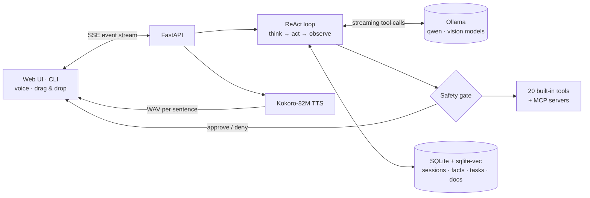

<div align="center">

# ◉ AETHER

### A local-first autonomous AI agent for study, research & productivity

*Runs entirely on your own computer: it plans, uses tools, remembers you, sees images, and talks back in a natural voice.*


-7DD3FC)


[](LICENSE)

<!-- Record per docs/DEMO_SCRIPT.md → shot list, then save as docs/media/hero.gif -->


</div>

---

## Why AETHER is an *agent*, not a chatbot

A chatbot answers. **AETHER works.** Give it a goal and it runs an explicit **ReAct loop**: it thinks, picks a tool, runs it, reads the result and decides what to do next, until the job is done. Every step streams to the UI live.

> **You:** *"Here's my timetable"* + 📷 screenshot
> **AETHER:** switches to a vision model → reads the image → `add_class` × 3 → *"Saved DBMS (Mon 9–10, Room 204), Operating Systems (Tue 11–12, Lab 2) and Statistics (Wed 2–3, Room 101)."*
>
> ⚡ `4 steps · add_class → add_class → add_class · 12.8s · local`

It does this with **no cloud API**: a local model through [Ollama](https://ollama.com), and a local SQLite memory, vector search and neural voice.

## Highlights

| | |
|---|---|
| 🧠 **Transparent ReAct engine** | Hand-written agent loop (no LangChain). Streams 10 typed events: thoughts, tokens, tool calls, approvals, memory |
| 🛡️ **Human-in-the-loop safety** | Risky actions (shell, Python, deleting, overwriting) **pause the agent** until you approve, with a plain-English risk summary |
| 📚 **Hybrid RAG** | PDFs, PowerPoint (incl. speaker notes) and Markdown. Embeddings + BM25 fused with weighted RRF, with citations like `[notes.pdf p.3]` |
| 🗂️ **Dual memory** | Every conversation persisted; long-term facts learned automatically, with near-duplicate merging, and fully editable |
| 👁️ **Vision** | Drop a screenshot; AETHER switches to an installed vision model **only for that answer**, then acts on what it sees |
| 🔌 **MCP client** | Plug in external [Model Context Protocol](https://modelcontextprotocol.io) servers (filesystem, GitHub, …) with per-server approval policies |
| 🎓 **Interactive study** | Quizzes become glass cards: multiple choice or 3D flip-cards. Weak topics are tracked and fed back into its memory |
| 🗓️ **Planner** | Deadlines and timetable in SQLite. Natural dates (*"next Friday 5pm"*) resolved **in code**; .ics export with alarms |
| 🎙️ **Neural voice** | Kokoro-82M, synthesised locally ~6× faster than real time, played **gaplessly** sentence by sentence, with an audio-reactive orb |
| 📊 **Telemetry** | Every reply shows its tool chain, steps, tokens, context-window use and latency |
| ✨ **Liquid-glass UI** | Next.js + Framer Motion: drifting light, cursor parallax, frosted glass, spring physics and a living orb (with a Calm mode) |

## How it works



1. Your goal arrives with **memory context**: relevant facts, upcoming deadlines, today's classes and your weak quiz topics.
2. The model streams tokens and tool calls. AETHER **validates and repairs** the arguments (small models often send `"5"` for `5`, or JSON inside text).
3. Safe tools run at once. Risky ones emit `approval_required`, and the loop **waits on an `asyncio.Future`** until you click Approve or Deny.
4. Results feed back into the loop until there's an answer. Then a quiet pass saves anything lasting it learned about you.

Full design: **[docs/ARCHITECTURE.md](docs/ARCHITECTURE.md)** (system and sequence diagrams, event protocol, design decisions).

## Feature tour

| | |
|---|---|
| <br/>**Safety gate.** A delete pauses the agent; Deny is focused by default | <br/>**Your notes, cited.** Answers come from your PDFs and slides, with page numbers |
| <br/>**Screenshot → actions.** A timetable photo becomes classes in the database | <br/>**Quiz cards.** Spring-animated cards; misses become weak topics |
| <br/>**Natural voice.** The orb breathes with the actual speech | <br/>**Telemetry.** The tool chain, tokens and latency of every reply |

<sub>GIFs: record them with the shot list in [docs/DEMO_SCRIPT.md](docs/DEMO_SCRIPT.md).</sub>

## Tools

| Area | Tools | Safety |
|---|---|---|
| Research | `web_search` (4 fallback sources), `read_webpage` (blocks private IPs) | safe |
| Knowledge | `search_knowledge_base`, `list_documents` | safe |
| Study | `make_quiz` | safe |
| Planner | `add_task`, `manage_tasks`, `add_class`, `manage_timetable` | deleting asks first |
| Memory | `remember`, `recall_memory`, `forget` | forgetting asks first |
| Notes & docs | `write_note`, `read_file`, `list_files`, `create_pdf` | overwriting asks first |
| Compute | `python_calculator` (its own AST interpreter, never `eval`) | safe |
| System | `run_python`, `run_shell_command`, `delete_file` | **always asks** |
| MCP | anything your MCP servers expose | read-only runs freely; the rest asks |

Adding a tool is one decorated function. The JSON schema comes from the type hints:

```python
@tool(description="Convert Celsius to Fahrenheit.", params={"celsius": "Temperature in °C"})
def to_fahrenheit(celsius: float) -> str:
    return f"{celsius * 9 / 5 + 32:.1f} °F"
```

## Making a 7B model behave like an agent

Small local models are fast and private, but unreliable. Most of AETHER's engineering went into making them dependable. Each item below came from a failure seen in live testing:

| Problem seen in testing | Fix |
|---|---|
| A valid tool call, followed by **12,930 tokens of hidden junk** (a 5-minute hang) | Output cap + close the stream 2.5 s after a tool call arrives: **53 s → 13 s** |
| *"Next Friday"* saved as a Tuesday | The model passes your words; **Python resolves the date** |
| *"I've tracked it"* after the tool call **failed** | The engine sends the model back once with the exact error |
| Tool calls written as text in code fences, with trailing commas | A lenient parser recovers them, plus a format-retry prompt |
| A quiz written as plain text instead of cards | An intent guard re-asks for `make_quiz` |
| Duplicate passages crowding out the right page in RAG | Passage dedup + weighted fusion + a minimum of 5 passages |
| Model reloads between calls | Every call uses the same `num_ctx` |

## Quick start

**Needs:** macOS or Linux, Python 3.11+, Node 20+, and [Ollama](https://ollama.com).

```bash
ollama pull qwen2.5:7b          # the brain: fast, reliable tool calling
ollama pull nomic-embed-text    # embeddings for RAG and memory
ollama pull qwen3.5:4b          # optional: vision + tools (screenshots)
```

```bash
git clone https://github.com/Piyuz-ui/aether.git && cd aether
./start.sh
```

`start.sh` sets everything up on the first run, checks Ollama, starts the backend and web app, and opens **http://localhost:3000**. **Ctrl+C** stops both. The voice model (~350 MB) downloads the first time AETHER speaks.

<details>
<summary><b>Manual setup, CLI and tests</b></summary>

```bash
# backend
cd backend
python3 -m venv .venv && source .venv/bin/activate
pip install -r requirements.txt
python api.py                 # API on :8000 (docs at /docs)
python cli.py                 # or: the terminal agent

# frontend (second terminal)
cd frontend && npm install && npm run dev

# tests
cd backend && python -m pytest -q
```
</details>

<details>
<summary><b>Connect MCP servers</b></summary>

Copy `backend/mcp_servers.example.json` to `backend/mcp_servers.json`. It uses the same format as Claude Desktop, plus two optional keys:

```json
{ "mcpServers": {
    "filesystem": { "command": "npx", "args": ["-y", "@modelcontextprotocol/server-filesystem", "./workspace"],
                    "approval": "auto" } } }
```

`approval`: `auto` runs read-only tools freely and asks for everything else; `always` asks for every call; `never` trusts the server. `include` limits which tools are exposed. Servers start in the background; check them in **Settings → MCP servers** or with `/mcp` in the CLI.
</details>

<details>
<summary><b>Configuration</b></summary>

Set these in `backend/.env` (see `.env.example`):

| Variable | Default | |
|---|---|---|
| `AETHER_MODEL` | `qwen2.5:7b` | falls back to another installed tool-calling model if it's missing |
| `AETHER_VISION_MODEL` | *(auto)* | preferred model for images |
| `AETHER_CONTEXT_LENGTH` | `16384` | |
| `AETHER_MAX_STEPS` | `8` | ReAct step limit |
| `AETHER_AUTO_MEMORY` | `true` | learn facts after each answer |
| `AETHER_MCP_CONFIG` | `backend/mcp_servers.json` | |
</details>

## Project structure

```
backend/
  aether/engine/     ReAct loop, safety broker, prompts, sessions
  aether/llm/        async Ollama client (streaming, capabilities) + tool-call repair parser
  aether/tools/      20 tools via the @tool registry (schemas from type hints)
  aether/memory/     SQLite store, hybrid RAG, facts, tasks, quizzes, sessions
  aether/mcp/        dependency-free MCP stdio client + server manager
  api.py             FastAPI: SSE chat, approvals, memory, tasks, knowledge, files, voice
  tts.py             Kokoro-82M neural voice
  cli.py             Rich terminal interface
  tests/             148 tests (fake LLM, real fake MCP server, generated PDFs and slides)
frontend/
  components/        glass UI: orb, chat, tool pills, approval modal, drawer, quiz deck, …
  lib/               SSE client, agent state, gapless voice engine, prefs
docs/                architecture, demo script
start.sh             one-command launcher
```

The repository also contains **Atlas** (`agent/`, `interfaces/`, `main.py`), the earlier Streamlit prototype that AETHER grew out of.

## Roadmap

- [ ] Remote (HTTP) MCP servers
- [ ] OCR for scanned PDFs
- [ ] `.docx` support
- [ ] Optional Gmail and Google Calendar connectors
- [ ] Wake-word detection fully on-device

## Built with

[Ollama](https://ollama.com) · [Qwen](https://github.com/QwenLM) · [nomic-embed-text](https://www.nomic.ai) · [Kokoro-82M](https://huggingface.co/hexgrad/Kokoro-82M) via [kokoro-onnx](https://github.com/thewh1teagle/kokoro-onnx) · [FastAPI](https://fastapi.tiangolo.com) · [sqlite-vec](https://github.com/asg017/sqlite-vec) · [Next.js](https://nextjs.org) · [Framer Motion](https://motion.dev) · [Tailwind CSS](https://tailwindcss.com) · [Model Context Protocol](https://modelcontextprotocol.io)

## License

[MIT](LICENSE) © 2026 Piyush Agrawal
