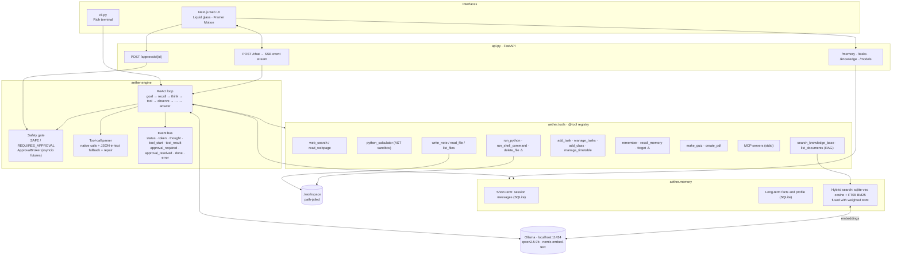
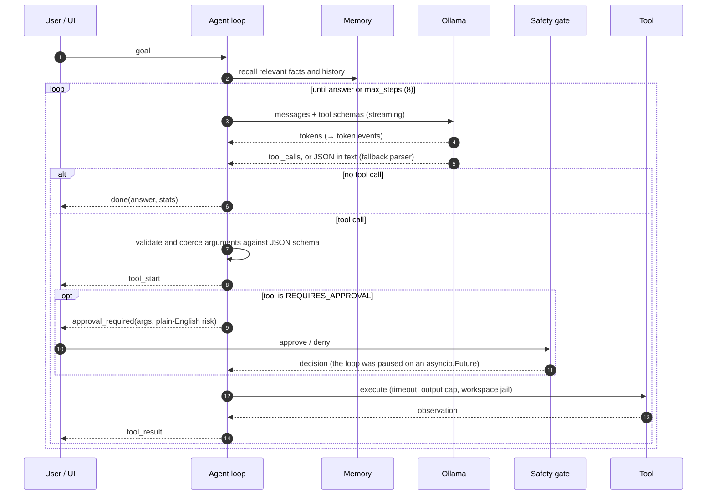
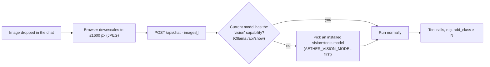
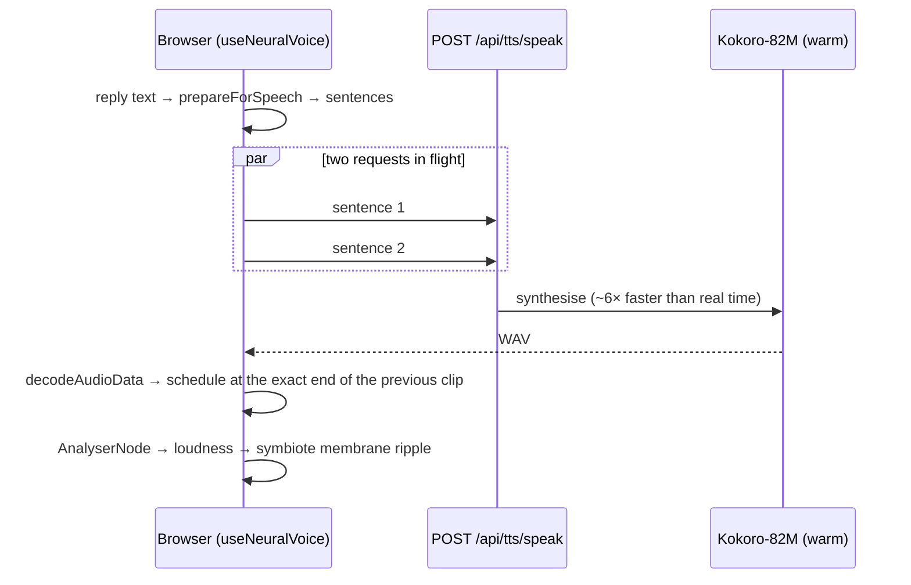

# AETHER: system architecture

AETHER is a local-first autonomous agent. A small, readable Python engine runs a ReAct-style tool-calling loop against a local Ollama model. Every step of that loop is published as a typed event, so the terminal, the API and the web UI all show the same live trace.

## 1. Big picture



## 2. The agent loop



Design choices:

| Concern | Choice | Why |
|---|---|---|
| Agent framework | Hand-written loop (about 300 lines) | Every step is inspectable. Nothing is hidden behind LangChain-style abstractions |
| Streaming | `async` generator of `AgentEvent`s | The same stream drives the CLI (Phase 1) and SSE (Phase 2) |
| Pausing for approval | `asyncio.Future` per request in an `ApprovalBroker` | The loop stays suspended without polling. The API resolves it from `POST /approvals/{id}` |
| Small-model robustness | Native tool calls → JSON-in-text extraction → lenient JSON repair → schema validation → error fed back for self-correction | 7B models often wrap calls in prose or code fences, or send `"5"` for an integer |
| File safety | `Workspace.resolve()` resolves symlinks and rejects anything outside `./workspace` | Blocks `../`, absolute-path and symlink escapes |
| Calculator safety | Own AST interpreter with whitelisted nodes and functions. No `eval` | No attribute access, imports, or dunder tricks. Size limits on `**` and repetition |
| Vector store | `sqlite-vec`, with an exact NumPy fallback | Single-file DB next to the rest of the SQLite data. ChromaDB was skipped because it pulls in a heavy dependency tree and its Python 3.14 wheel support is uncertain |
| Retrieval | Hybrid: semantic (nomic-embed-text) + keyword (FTS5 BM25), weighted Reciprocal Rank Fusion, duplicate passages collapsed, at least 5 passages per query | Embeddings miss exact terms (course codes, formulas); BM25 misses paraphrases. Together they cover both |
| Dates | The model passes dates in the user's words ("next Friday 5pm") and Python resolves them | 7B models get calendar maths wrong; code doesn't |
| Runaway generations | `num_predict` cap per call, plus the stream is closed 2.5 s after a tool call arrives | Small models sometimes keep generating hidden junk after a valid call. Without this, one reply took 5 minutes |
| Self-correction | If the model tries to finish with an unfixed tool failure, or announces a tool it never called, the engine sends it back once | Stops false claims like "I've tracked it" when the call actually failed |
| Auto-learning | After `done`, a small extraction call saves new lasting facts. ≥ 80% similar facts are skipped. It uses the same `num_ctx` as chat | The answer is never delayed, there are no duplicates, and the model never reloads |

## 3. Event protocol

Every event is `{"type", "step", "ts", "data"}`.

| type | data | Used for |
|---|---|---|
| `status` | `state`: `thinking` \| `using_tool` \| `awaiting_approval` \| `idle` | Drives the living symbiote (its body language per state) |
| `token` | `text`, `channel`: `content` \| `thinking` | Live typing |
| `thought` | `text` | The agent's reasoning before a tool call |
| `tool_start` | `call_id`, `name`, `args`, `risk`, `icon` | Tool pill appears |
| `approval_required` | `approval_id`, `call_id`, `name`, `args`, `summary` | Safety modal |
| `approval_resolved` | `approval_id`, `approved`, `reason` | Modal closes |
| `tool_result` | `call_id`, `name`, `ok`, `output`, `duration_s` | Pill shows its result |
| `done` | `answer`, `stats` (tokens, context %, timing) | Final message |
| `memory` | `saved`: facts learned this turn | "🧠 remembered …" toast |
| `error` | `message`, `hint` | Recovery instructions (for example "run `ollama pull …`") |

## 4. Directory layout

```
ai agent/
├── backend/
│   ├── aether/
│   │   ├── config.py              settings (AETHER_* env vars / backend/.env)
│   │   ├── events.py              AgentEvent + event types
│   │   ├── metrics.py             tokens, context window use, timing
│   │   ├── workspace.py           path-jail for all file access
│   │   ├── llm/
│   │   │   ├── ollama.py          async streaming client, model resolution, errors with hints
│   │   │   └── parsing.py         tool-call extraction from text + lenient JSON repair
│   │   ├── engine/
│   │   │   ├── agent.py           the ReAct loop
│   │   │   ├── prompts.py         system prompt builder
│   │   │   ├── safety.py          ApprovalBroker
│   │   │   └── session.py         conversation history with a size budget
│   │   ├── tools/
│   │   │   ├── registry.py        @tool decorator, JSON schema, validation, execution
│   │   │   ├── calculator.py      python_calculator (AST sandbox)
│   │   │   ├── web.py             web_search, read_webpage (blocks private IPs)
│   │   │   ├── notes.py           write_note, read_file, list_files
│   │   │   ├── system.py          run_python, run_shell_command, delete_file  ⚠ approval
│   │   │   ├── documents.py       create_pdf (Markdown → styled PDF)
│   │   │   ├── study.py           make_quiz
│   │   │   ├── knowledge.py       search_knowledge_base, list_documents
│   │   │   ├── planner.py         add_task, manage_tasks, add_class, manage_timetable
│   │   │   └── memory_tools.py    remember, recall_memory, forget
│   │   ├── memory/
│   │   │   ├── store.py           one SQLite file: sessions, messages, facts, tasks, timetable, docs, chunks (+FTS5)
│   │   │   ├── embedder.py        Ollama embeddings (nomic prefixes), graceful keyword-only fallback
│   │   │   ├── knowledge.py       PDF/MD/TXT ingestion with progress, chunking, hybrid search
│   │   │   ├── facts.py           long-term facts with near-duplicate merging
│   │   │   ├── taskbook.py        tasks + timetable, natural-language date parsing
│   │   │   ├── sessions.py        PersistentSession (short-term memory in SQLite)
│   │   │   ├── quizzes.py         quizzes + weak-topic tracking
│   │   │   └── __init__.py        MemorySystem: recall context + auto fact extraction
│   ├── cli.py                     Rich terminal runner
│   │   ├── mcp/                   MCP stdio client + manager (mcp_servers.json)
│   ├── api.py                     FastAPI: SSE chat, approvals, sessions, memory, tasks, knowledge, voice
│   ├── tts.py                     Kokoro-82M neural voice
│   ├── tests/
│   ├── requirements.txt
│   └── .env.example
├── frontend/                      Next.js 16 + Tailwind 4 + Framer Motion (liquid-glass UI)
└── docs/ARCHITECTURE.md
```

## 5. Dependencies

Backend (`backend/requirements.txt`, Python 3.11+): httpx, rich, ddgs, pydantic, pydantic-settings, fastapi, uvicorn, sse-starlette, python-multipart, pypdf, sqlite-vec, numpy, pytest, pytest-asyncio.

Frontend (`frontend/package.json`, Phase 3): next 16.4, react / react-dom 19.3, framer-motion 14.14, tailwindcss 4.3 (+ @tailwindcss/postcss), lucide-react, clsx, typescript 5.9.

Ollama:

```bash
ollama pull qwen2.5:7b          # default brain: fast and reliable tool calling
ollama pull nomic-embed-text    # embeddings for RAG and memory
```

If `qwen2.5:7b` isn't installed, AETHER uses the first installed model from its fallback list (`qwen3:14b`, `qwen3:8b`, `llama3.1:8b`, …) and says so.

## 6. HTTP API (Phase 2)

Run `python api.py`, then open the interactive docs at `http://127.0.0.1:8000/docs`.

| Method | Path | Purpose |
|---|---|---|
| GET | `/api/health` | Ollama status, model, embeddings, tool count |
| GET / POST | `/api/models` | List installed models and switch the brain |
| GET | `/api/tools` | Tools with category, icon and risk |
| POST | `/api/chat` | `{message, session_id?}` → **SSE** stream: `session`, then the agent events |
| GET | `/api/approvals` | Pending approval requests |
| POST | `/api/approvals/{id}` | `{approved, reason?}` resumes the paused loop |
| GET / PATCH / DELETE | `/api/sessions[/{id}]` | Chat history, as a UI-ready transcript with tool steps |
| GET / POST / PATCH / DELETE | `/api/memory/facts[/{id}]` | Memory Inspector |
| GET / POST / PATCH / DELETE | `/api/tasks[/{id}]` | Tasks, deadlines, exams, reminders |
| GET / POST / DELETE | `/api/timetable[/{id}]` | Weekly classes |
| GET / POST / DELETE | `/api/knowledge[/{id}]` | Upload (multipart; indexed in the background, poll for `progress`) and delete |
| POST | `/api/knowledge/{id}/reindex` | Retry indexing (e.g. after pulling the embedding model) |
| GET | `/api/knowledge/search?q=` | Hybrid search, for debugging RAG |

When a client disconnects mid-stream, the run is closed and any pending approval is denied.
A chat that is still answering returns `409` to a second message.

## 7. Later additions

### Vision routing



Images live only in the current turn's model messages. History stores the text plus an image count, so later turns stay small.

### MCP client

`aether/mcp/client.py` speaks newline-delimited JSON-RPC 2.0 over a server's stdin/stdout: `initialize`, then `notifications/initialized`, paginated `tools/list`, `tools/call`, and answering the server's `ping`. `manager.py` registers each discovered tool as `<server>__<tool>`, using the server's own JSON Schema. Risk comes from the per-server `approval` policy plus the tool's `readOnlyHint` annotation. Servers start in the background at API startup, and the tools are removed again on shutdown.

### Interactive quizzes

`make_quiz` stores a validated quiz and returns its ID. Validation repairs answers given as "B" or as an index, and drops questions whose answer isn't one of the options. The UI renders the quiz as cards and posts each answer to `/api/quizzes/{id}/answer`. A topic with at least 2 attempts and under 60% accuracy becomes a long-term memory fact, and appears in the memory context as a weak topic. An *intent guard* in the engine sends the model back once if it writes a quiz as plain text.

### Neural voice



Clips are scheduled on the `AudioContext` clock (`start(at)`, where `at` is when the previous clip ends), so playback is gapless. Synthesis is 5–6× faster than playback, so the next sentence is always decoded before the current one finishes. With auto-speak on, playback starts at the first *finished* sentence while the reply is still being written. Stop, a new question, or Listen on another reply aborts in-flight requests and stops the scheduled sources. Engines: Kokoro via MLX when it's importable, Kokoro via ONNX otherwise, and the browser's `speechSynthesis` as a last resort.

### Telemetry

The final assistant message of each turn carries `meta.stats`: model, model calls, per-tool seconds, tokens in and out, context-window use, tokens per second and wall time. It's stored in the `messages.meta` column, which was added by an automatic migration, so the chip still appears on reopened chats. `Session.history()` strips `meta` (and images) before anything is sent back to the model.
