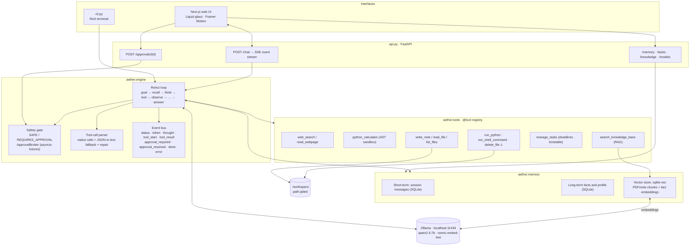
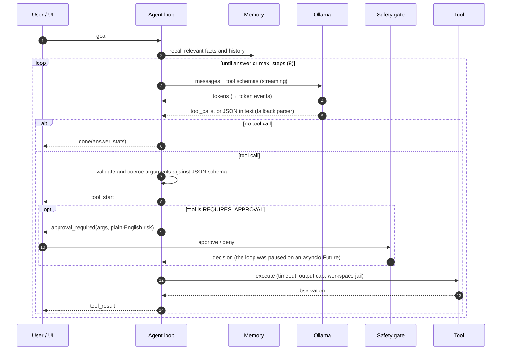

# AETHER: system architecture

AETHER is a local-first autonomous agent. A small, readable Python engine runs a ReAct-style tool-calling loop against a local Ollama model. Every step of that loop is published as a typed event, so the terminal, the API and the web UI all show the same live trace.

## 1. Big picture



## 2. The agent loop



Design choices:

| Concern | Choice | Why |
|---|---|---|
| Agent framework | Hand-written loop (about 300 lines) | Every step is inspectable. Nothing is hidden behind LangChain-style abstractions |
| Streaming | `async` generator of `AgentEvent`s | The same stream drives the CLI (Phase 1) and SSE (Phase 2) |
| Pausing for approval | `asyncio.Future` per request in an `ApprovalBroker` | The loop stays suspended without polling. The API resolves it from `POST /approvals/{id}` |
| Small-model robustness | Native tool calls → JSON-in-text extraction → lenient JSON repair → schema validation → error fed back for self-correction | 7B models often wrap calls in prose or code fences, or send `"5"` for an integer |
| File safety | `Workspace.resolve()` resolves symlinks and rejects anything outside `./workspace` | Blocks `../`, absolute-path and symlink escapes |
| Calculator safety | Own AST interpreter with whitelisted nodes and functions. No `eval` | No attribute access, imports, or dunder tricks. Size limits on `**` and repetition |
| Vector store | `sqlite-vec`, with an exact NumPy fallback | Single-file DB next to the rest of the SQLite data. ChromaDB was skipped because it pulls in a heavy dependency tree and its Python 3.14 wheel support is uncertain |

## 3. Event protocol

Every event is `{"type", "step", "ts", "data"}`.

| type | data | Used for |
|---|---|---|
| `status` | `state`: `thinking` \| `using_tool` \| `awaiting_approval` \| `idle` | Drives the living orb |
| `token` | `text`, `channel`: `content` \| `thinking` | Live typing |
| `thought` | `text` | The agent's reasoning before a tool call |
| `tool_start` | `call_id`, `name`, `args`, `risk`, `icon` | Tool pill appears |
| `approval_required` | `approval_id`, `call_id`, `name`, `args`, `summary` | Safety modal |
| `approval_resolved` | `approval_id`, `approved`, `reason` | Modal closes |
| `tool_result` | `call_id`, `name`, `ok`, `output`, `duration_s` | Pill shows its result |
| `done` | `answer`, `stats` (tokens, context %, timing) | Final message |
| `error` | `message`, `hint` | Recovery instructions (for example "run `ollama pull …`") |

## 4. Directory layout

```
ai agent/
├── backend/
│   ├── aether/
│   │   ├── config.py              settings (AETHER_* env vars / backend/.env)
│   │   ├── events.py              AgentEvent + event types
│   │   ├── metrics.py             tokens, context window use, timing
│   │   ├── workspace.py           path-jail for all file access
│   │   ├── llm/
│   │   │   ├── ollama.py          async streaming client, model resolution, errors with hints
│   │   │   └── parsing.py         tool-call extraction from text + lenient JSON repair
│   │   ├── engine/
│   │   │   ├── agent.py           the ReAct loop
│   │   │   ├── prompts.py         system prompt builder
│   │   │   ├── safety.py          ApprovalBroker
│   │   │   └── session.py         conversation history with a size budget
│   │   ├── tools/
│   │   │   ├── registry.py        @tool decorator, JSON schema, validation, execution
│   │   │   ├── calculator.py      python_calculator (AST sandbox)
│   │   │   ├── web.py             web_search, read_webpage (blocks private IPs)
│   │   │   ├── notes.py           write_note, read_file, list_files
│   │   │   └── system.py          run_python, run_shell_command, delete_file  ⚠ approval
│   │   └── memory/                Phase 2: SQLite store, vector store, ingestion
│   ├── cli.py                     Rich terminal runner
│   ├── api.py                     Phase 2: FastAPI + SSE
│   ├── tests/
│   ├── requirements.txt
│   └── .env.example
├── frontend/                      Phase 3: Next.js + Tailwind + Framer Motion
└── docs/ARCHITECTURE.md
```

## 5. Dependencies

Backend (`backend/requirements.txt`, Python 3.11+): httpx, rich, ddgs, pydantic, pydantic-settings, fastapi, uvicorn, sse-starlette, python-multipart, pypdf, sqlite-vec, numpy, pytest, pytest-asyncio.

Frontend (`frontend/package.json`, Phase 3): next 16.4, react / react-dom 19.3, framer-motion 14.14, tailwindcss 4.3 (+ @tailwindcss/postcss), lucide-react, clsx, typescript 5.9.

Ollama:

```bash
ollama pull qwen2.5:7b          # default brain: fast and reliable tool calling
ollama pull nomic-embed-text    # embeddings for RAG and memory
```

If `qwen2.5:7b` isn't installed, AETHER uses the first installed model from its fallback list (`qwen3:14b`, `qwen3:8b`, `llama3.1:8b`, …) and says so.
